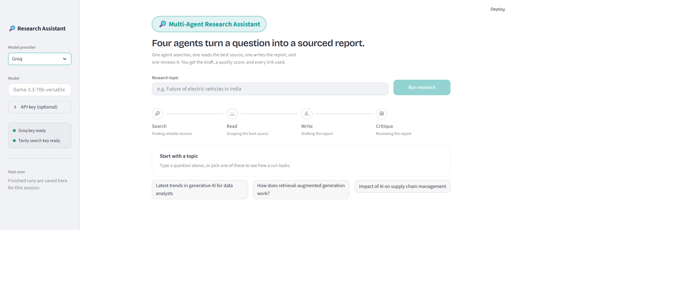

# Multi-Agent Research Studio

Four AI agents turn a question into a sourced research report. One agent searches the web, one reads the best source, one writes the report, and one reviews it. You get the draft, a quality score and every link used, all from a Streamlit interface.



## How it works

| Step | Agent | What it does |
|------|-------|--------------|
| 1 | Search | Uses Tavily to find up to 3 recent, reliable sources on the topic |
| 2 | Read | Picks the most relevant URL and scrapes its text for deeper content |
| 3 | Write | Drafts a report with an introduction, key findings, conclusions and sources |
| 4 | Critique | Reviews the report and returns a score out of 10, strengths, areas to improve and a one-line verdict |

The Search and Read steps are tool-using LangChain agents. The Write and Critique steps are prompt chains. `pipeline.py` runs the four steps in order and streams progress events to the interface.

## Features

- Live pipeline tracker showing each agent's progress and timing
- Critic score with a short verdict, plus total time, word count and source count
- Tabs for the report, critic feedback, sources and raw agent output
- Download the report as `.md` or `.txt`
- History of past runs in the sidebar for the current session
- Switch between Gemini, Groq and Mistral with one setting
- Command-line mode: run `python pipeline.py` to use the pipeline without the interface

## Tech stack

Python, Streamlit, LangChain, Tavily, BeautifulSoup and Requests, with Gemini, Groq or Mistral models.

## Project structure

```
app.py            Streamlit interface
pipeline.py       Runs the four steps in order and streams progress
agents.py         Model setup, search and reader agents, writer and critic chains
tools.py          Tavily web search and web page scraping tools
requirements.txt  Python dependencies
.env.example      Template for your API keys
```

## Setup

You need Python 3.10 or later.

**1. Clone the repo**

```bash
git clone https://github.com/SusnataB07/Multi-Agent-Research-Assistant.git
cd Multi-Agent-Research-Assistant
```

**2. Create and activate a virtual environment**

```bash
python -m venv .venv

# Windows (PowerShell)
.venv\Scripts\Activate.ps1

# macOS / Linux
source .venv/bin/activate
```

**3. Install dependencies**

```bash
pip install -r requirements.txt
```

**4. Add your API keys**

Copy `.env.example` to `.env`:

```bash
# Windows (PowerShell)
copy .env.example .env

# macOS / Linux
cp .env.example .env
```

Then fill in two things: the key for your model provider, and a Tavily key for web search.

| Provider (`LLM_PROVIDER`) | Key to set | Default model | Get a key |
|---------------------------|------------|---------------|-----------|
| `gemini` (default) | `GOOGLE_API_KEY` | `gemini-3.5-flash` | [Google AI Studio](https://aistudio.google.com/apikey) |
| `groq` | `GROQ_API_KEY` | `llama-3.3-70b-versatile` | [Groq Console](https://console.groq.com/keys) |
| `mistral` | `MISTRAL_API_KEY` | `mistral-small-2506` | [Mistral Console](https://console.mistral.ai) |

`TAVILY_API_KEY` is required for every provider. Get one at [tavily.com](https://tavily.com).

To use a different model, set `LLM_MODEL` in `.env`.

## Run

```bash
streamlit run app.py
```

The app opens at `http://localhost:8501`. Enter a topic and click **Run research**.

## Troubleshooting

- **"Could not load the pipeline or agents: Missing API key":** the key for your `LLM_PROVIDER` is not set in `.env`. Paste it straight after the `=`, with no spaces or quotes.
- **Search fails:** check that `TAVILY_API_KEY` is set.
- **Rate limit or quota error:** wait a minute and retry, or switch `LLM_PROVIDER` to another provider.
- **Model not found:** the default model may have been retired or renamed. Set `LLM_MODEL` in `.env` to a current model name for your provider.
- **Changes to `.env` not picked up:** stop Streamlit and run it again, since the file is read at startup.
- **Some pages return no content:** the reader agent can only scrape pages that allow it, and it reads the first 3,000 characters of the page it picks.

## Notes

Never commit your `.env` file. It is listed in `.gitignore` so your keys stay local.
